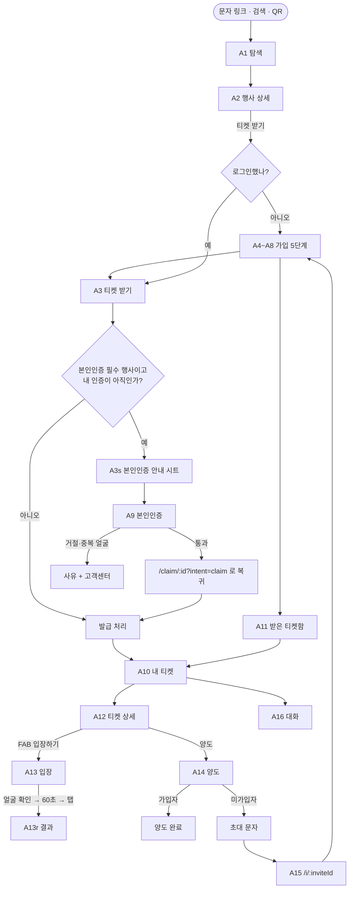
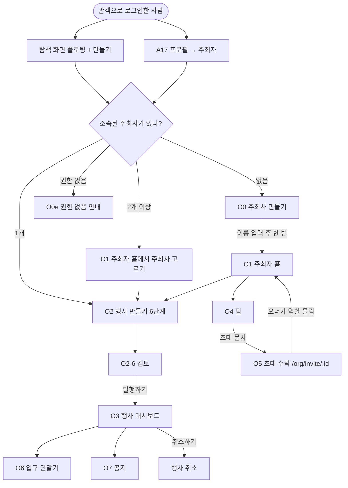
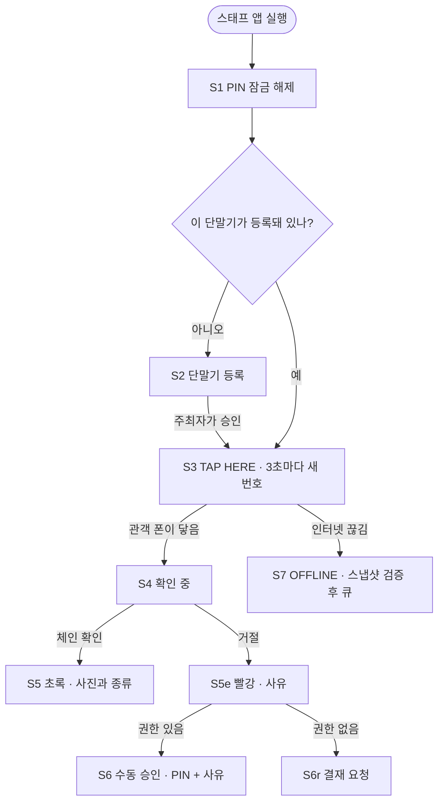

# MONTI UX 플로우 설계 · MVP (2026-09-22)

**범위**: 관객 / 주최자 / 현장 스태프 3개 페르소나의 화면 단위 흐름, 화면별 정의, 현재 코드와의 차이, 실행 순서.
**대상 코드**: `MONTI-web` 워크트리 `mvp-web` 브랜치. 인용은 전부 `apps/web/src/` 기준(백엔드·컨트랙트는 경로를 밝힌다).
**데모 기한**: 2026-10-13. P0 = 그날 없으면 시연이 깨지는 것.

## 0. 전제와 어휘 (읽기 전에)

1. **금지어**: `지갑 NFT 민팅 가스 체인 토큰 트랜잭션 wallet mint gas chain token transaction blockchain monad` (`MONTI-web/packages/shared/src/constants.ts:85-101`). 린트는 `apps/web/src/attendee`와 `apps/web/src/shared/copy`만 본다 — 주최자 문구는 `organizer/copy.ts`에 따로 둔다.
2. **배지 용어를 하나로 통일한다.** 지금 행사 쪽은 `KYC 필요`(`shared/copy/ko.ts:51`), 프로필 쪽은 `인증 완료 / 미인증`(`ko.ts:53`)이라 같은 개념이 두 이름으로 나온다. 앞으로 **행사 요구 = "본인인증 필수"**, **내 상태 = "인증 완료 / 인증 전"** 으로 고정한다. 'KYC'는 관객 화면에서 사라진다.
3. **로그인 상태 구분.** `/events/:id`는 로그인 없이 열린다(`router.tsx:56`은 `RequireSession` 바깥). 그래서 이 화면에서 내 인증 배지를 그릴 때는 반드시 `useSession().status === 'signedIn'`을 먼저 본다. 아니면 비로그인 방문자에게 서버 호출이 나가 실패한다.
4. **주최자 라우트는 `/organizer/*`가 아니라 `/org/*`다**(`router.tsx:81`). 기획서 표기와 코드가 다르니 이 문서는 코드를 따른다.
5. **오류 문구는 화면마다 쓰지 않는다.** `EnvioError.kind`(`shared/envio/client.ts:7`)와 콜러블 `reason`(`shared/api/functions.ts:65`)이 이미 원인을 구분해서 주는데, 화면들이 전부 `copy.common.error` 한 문장으로 뭉갠다(`Discover.tsx:44`, `EventDetail.tsx:56`, `Claim.tsx:97`, `List.tsx:30`). 이것이 창업자가 본 "문제가 생겼어요"의 정체다.

---

## A. 페르소나별 전체 플로우

### A-1. 관객 (Attendee)

| ID | 화면(경로) | 한 줄 |
|---|---|---|
| A1 | 탐색 `/` | 날짜·지역·테마 필터와 제목 검색으로 행사를 고른다 |
| A2 | 행사 상세 `/events/:id` | 행사 정보 + **행사 요구 배지 + 내 인증 배지** + 티켓 받기 |
| A3 | 티켓 받기 `/claim/:id` | 종류를 고르고 한 번 눌러 티켓을 받는다 |
| A3s | 본인인증 안내 시트 | 인증이 필요하다고 알리고 인증 화면으로 보낸다 |
| A4~A8 | 가입 `/signup/{phone,verify,passkey,device,done}` | 번호 → 인증번호 → 얼굴·지문 잠금 → 이 휴대폰 등록 → 완료 |
| A9 | 본인인증 `/me/verify` | 신분증·얼굴 확인을 열고, 결과를 기다렸다가 **원래 하던 일로 돌아간다** |
| A10 | 내 티켓 `/tickets` | 가진 티켓과 상태 배지 목록 |
| A11 | 받은 티켓함 `/tickets/inbox` | 남이 보낸 티켓을 받는 곳 |
| A12 | 티켓 상세 `/tickets/:tokenId` | 상태·안내와 플로팅 "입장하기" |
| A13 | 입장 `/tickets/:tokenId/enter` | 얼굴 확인 → 60초 → 단말기에 대기 |
| A14 | 양도 `/tickets/:tokenId/transfer/*` | 별명·주소·전화번호로 찾아 넘기기 |
| A15 | 초대 랜딩 `/i/:inviteId` | 문자 링크가 떨어지는 곳. 가입으로 보냈다가 받은 티켓함으로 데려온다 |
| A16 | 대화 `/chats`, `/chats/:id` | 행사별 대화방 |
| A17 | 프로필 `/me` | 별명·언어·잠금·인증 상태·**주최자 되기**·계정 삭제 |

### A-2. 주최자 (Organizer)

| ID | 화면(경로) | 한 줄 |
|---|---|---|
| O0 | 주최사 만들기 `/org/become` | 주최사 이름을 적고 한 번 눌러 주최자가 된다 (**신설**) |
| O1 | 주최자 홈 `/org` | 내 주최사·내 행사 목록 + 플로팅 "만들기" (**지금은 번호 직접 입력**) |
| O2 | 행사 만들기 `/org/new` | 기본→일시→종류→규칙→스태프→검토 6단계 |
| O3 | 대시보드 `/org/events/:id` | 판매·입장·참석자, 발행/취소 |
| O4 | 팀 `/org/team/:orgId` | 초대 만들기·목록·역할 올리기 |
| O5 | 초대 수락 `/org/invite/:id` | 초대를 내 계정에 묶고 오너의 마지막 승인을 기다린다 |
| O6 | 입구 단말기 `/org/events/:id/gates` | 스태프 단말기 승인·열기·닫기·폐기 |
| O7 | 공지 | 행사 대화방에 고정 공지를 남긴다 |

### A-3. 현장 스태프 (안드로이드 전용 앱)

웹의 `/staff/*`는 아직 빈 껍데기다(`staff/Console.tsx:1-3`). 실제 검표는 sub-plan 04의 안드로이드 앱이 한다.

**한 줄씩**: S1 PIN = 단말기를 내려놔도 남이 못 쓰게 잠근다 · S2 등록 = 보안 칩 키를 만들고 주최자 승인 대기 · S3 TAP HERE = 3초마다 새 1회용 번호를 내보낸다(읽지 않는다) · S4 확인 중 = 관객 서명을 보내고 결과를 기다린다 · S5 결과 = 초록(사진·종류) 또는 빨강(사유) · S6 수동 승인/결재 요청 = PIN + 사유 코드 · S7 OFFLINE = 로컬 검증 후 큐에 쌓았다가 복구되면 전송.

---

## B. 화면별 정의

형식: **목적 / 주 동작(하나) / 보조 / 빈 상태 / 오류 문구 / 진입·이탈**. 문구는 그대로 쓸 한국어다.

### A1 탐색 `/` — `attendee/discover/Discover.tsx`
- 목적: 지금 신청할 수 있는 행사를 찾는다. | 주 동작: 행사 카드 열기.
- 보조: 검색, 날짜·지역·테마 필터, **플로팅 "만들기"(신설, 로그인한 사람에게만)**.
- 빈 상태: 필터 결과 0건 → `조건에 맞는 행사가 없어요.` + `필터 지우기` 버튼(신설).
- 오류: 오프라인 `인터넷에 연결되어 있지 않아요. 연결되면 자동으로 다시 불러올게요.` / 인덱서 무응답 `행사 목록을 가져오지 못했어요. 잠시 뒤 다시 시도해 주세요.` + `다시 시도`.
- 진입: 앱 시작, 탭. 이탈: `/events/:id`, `/org/new`(또는 `/org/become`).

### A2 행사 상세 `/events/:id` — `attendee/discover/EventDetail.tsx`
- 목적: 신청할지 판단할 정보를 한 화면에 준다. | 주 동작: `티켓 받기`.
- 보조: 지도 링크, 공유, 공개 기록. **배지 두 개를 나란히**: 행사 요구 `본인인증 필수` + 내 상태 `인증 완료` 또는 `인증 전`(로그인 상태에서만).
- 빈 상태: 메타데이터 미로딩 → 제목 자리에 `제목을 불러오지 못했어요`, 나머지는 그대로 보여준다.
- 오류: 없는 행사 `그 행사를 찾을 수 없어요.` / 취소됨 `취소된 행사예요.`(받기 버튼 숨김) / 전 종류 매진 `모든 종류가 마감됐어요.`(받기 버튼 비활성) / 인덱서 `행사 정보를 가져오지 못했어요. 잠시 뒤 다시 시도해 주세요.`
- 진입: A1, 공유 링크, 티켓 상세. 이탈: `/claim/:id`.

### A3 티켓 받기 `/claim/:id` — `attendee/claim/Claim.tsx`
- 목적: 종류를 고르고 티켓을 받는다. | 주 동작: `티켓 받기`.
- 보조: 종류 선택, 내 인증 배지(A2와 같은 부품).
- **자동 재개**: 주소에 `intent=claim`이 있고 `kycLevel ≥ 1`이며 인증 조회가 끝났으면(`isLoading === false`) 한 번만 스스로 받기를 실행한다. 실행 전에 주소에서 `intent`를 먼저 지운다(`replace: true`).
- 빈 상태: 종류 0개 → `아직 받을 수 있는 티켓이 없어요.`
- 오류: 1인 한도 `이 행사에서 받을 수 있는 티켓을 이미 다 받았어요.` / 매진 `이 종류는 마감됐어요. 다른 종류를 골라 주세요.` / 취소된 행사 `취소된 행사예요.` / 확인 지연 `아직 확인 중이에요. 잠시 뒤 내 티켓에서 확인해 주세요.` / 그 외 `티켓을 받지 못했어요. 잠시 뒤 다시 시도해 주세요.`
- 진입: A2. 이탈: `/tickets`, `/me/verify?...`.

### A3s 본인인증 안내 시트 — `Claim.tsx:19-30`
- 목적: 왜 막혔는지와 다음 한 걸음을 알린다. | 주 동작: `본인인증 하기`.
- 보조: `닫기`. 본문 `신분증과 얼굴을 한 번 확인하면 이 행사와 앞으로의 행사에서 다시 하지 않아도 돼요.`
- 이탈(**변경**): `/me/verify?returnTo=/claim/:id%3Fintent%3Dclaim%26tier%3DN` — 지금은 `/events/:id`로 돌아가서 다시 두 번 눌러야 한다(`Claim.tsx:26`).
- 오류: 없음(이 시트는 조회를 하지 않는다).

### A4 가입1 번호 `/signup/phone`
- 목적: 번호를 받고 문자를 보낸다. | 주 동작: `인증번호 받기`. 보조: 국가 번호. 진입: A2의 받기, `/i/:inviteId`. 이탈: `/signup/verify`.
- 오류: 형식 `번호를 다시 확인해 주세요.` / 문자 서비스 중단 `지금은 문자 인증을 쓸 수 없어요. 잠시 뒤 다시 시도해 주세요.` / 과다 `요청이 너무 많아요. 잠시 뒤 다시 시도해 주세요.` / 오프라인 `인터넷에 연결되어 있지 않아요.`

### A5 가입2 인증번호 `/signup/verify`
- 목적: 6자리로 번호 소유를 확인한다. | 주 동작: `확인`. 보조: 60초 뒤 `다시 보내기`.
- **문자 미수신 상태 추가**: 60초가 지나면 `문자가 오지 않았나요?` 아래에 `다시 보내기`와 `번호 고치기` 두 개를 같이 둔다. 지금은 `다시 보내기`만 있다.
- 오류: `인증번호가 맞지 않아요.` / `인증번호가 만료됐어요. 다시 받아 주세요.` / 이미 가입 → 로그인 화면으로 `이미 가입된 번호예요. 로그인해 주세요.`
- 진입: A4. 이탈: `/signup/passkey`(안드로이드 자동 인증이면 화면이 스스로 넘어간다, `Verify.tsx:104-110`).

### A6 가입3 잠금 `/signup/passkey`
- 목적: 외울 비밀번호 없이 계정을 잠근다. | 주 동작: `잠금 설정하기`.
- **문구 변경(P0)**: 제목 `Face ID로 잠금 설정`(`ko.ts:21`)은 안드로이드에서 거짓말이다 → **`얼굴이나 지문으로 잠그기`**. 본문은 그대로가 좋다.
- 오류: 취소 `잠금 설정을 취소했어요. 다시 시도해 주세요.` / 미지원 `이 휴대폰에서는 얼굴·지문 잠금을 쓸 수 없어요.` / 재시작 `가입을 처음부터 다시 해 주세요.`
- 진입: A5. 이탈: `/signup/device`.

### A7 가입4 휴대폰 등록 `/signup/device`
- 목적: 입장할 때 이 휴대폰만 인정되도록 등록한다. | 주 동작: `등록하기`.
- **판단**: 단계 자체는 남긴다 — 이 등록이 입장의 보안 근거이고, 실패하면 QR로 갈라져야 하므로 조용히 섞을 수 없다. 대신 **제목을 약속으로 바꾼다**: `이 휴대폰을 입장용으로 등록할게요` → **`입장은 이 휴대폰으로만`**, 본문 `표를 다른 사람이 대신 쓸 수 없게, 이 휴대폰만 입구에서 인정돼요.`
- 오류: 밀림 `지금 처리가 밀려 있어요. 잠시 뒤 다시 눌러 주세요.` / 지연 `등록이 오래 걸리고 있어요. 잠시 뒤 다시 눌러 주세요.` / 보안 칩 없음 `이 휴대폰에서는 입장 기능을 쓸 수 없어요. 입구 스태프에게 말씀해 주세요.` + `이대로 계속하기`.
- 진입: A6. 이탈: `/signup/done`.

### A8 가입5 완료 `/signup/done`
- 목적: 끝났다고 알리고 하려던 일로 보낸다. | 주 동작: `행사 둘러보기`. | 오류: 없음(받은 티켓 자동 수령 실패는 조용히 넘기고 받은 티켓함이 다시 보여준다).
- **변경**: 받기를 하려다 가입했으면 버튼을 **`티켓 받으러 가기`**로 바꾸고 원래 행사로 보낸다(초대로 왔으면 지금처럼 받은 티켓함, `Done.tsx:24`).

### A9 본인인증 `/me/verify` — `attendee/me/VerifyIdentity.tsx`
- 목적: 신분증·얼굴 확인을 열고 결과를 기다렸다가 **원래 하던 일로 돌려보낸다**. | 주 동작: `본인인증 하기`.
- 보조: 결과 대기 중 스피너와 `확인하고 있어요. 잠시만 기다려 주세요.`
- 오류: 중복 얼굴 `이미 계정이 있습니다. 기존 계정으로 로그인해 주세요.` / 거절 `본인 확인에 실패했어요. 다시 시도해 주세요.` + 고객센터 링크 / 세션 겹침 `잠시 후 다시 시도해 주세요.` / 90초 초과 `아직 확인 결과가 오지 않았어요. 잠시 뒤 다시 확인해 주세요.` + `다시 시도`.
- 진입: A3s, A11, A17. 이탈: `returnTo`(기본 `/me`).

### A10 내 티켓 `/tickets`
- 목적: 가진 티켓을 상태와 함께 본다. | 주 동작: 티켓 열기. 보조: 받은 티켓함 링크.
- 빈 상태: `아직 티켓이 없어요.` + **`행사 둘러보기` 버튼(신설)** — 지금은 막다른 길이다.
- 오류: 인덱서 `티켓 목록을 가져오지 못했어요. 잠시 뒤 다시 시도해 주세요.` + `다시 시도`.

### A11 받은 티켓함 `/tickets/inbox`
- 목적: 남이 보낸 티켓을 받는다. | 주 동작: 행별 `받기`. | 빈 상태: `받은 티켓이 없어요.` | 인증 필요 행: `본인인증 후 받을 수 있어요` + 인증 버튼(`Inbox.tsx:49`).
- 오류: 만료 `초대가 만료됐어요. 다시 보내 달라고 해 주세요.` / 사라짐 `이 초대는 더 이상 남아 있지 않아요.` / 한도 `이 행사 티켓을 이미 최대 수만큼 갖고 있어요.`

### A12 티켓 상세 `/tickets/:tokenId`
- 목적: 이 티켓으로 지금 할 수 있는 일을 준다. | 주 동작: 플로팅 `입장하기`(`Detail.tsx:44`). 보조: `양도`, 행사 링크.
- 빈 상태: 없음. | 오류: 없는 티켓 → 지금은 `문제가 생겼어요`(`Detail.tsx:25`) → **`이 티켓을 찾을 수 없어요.`** + `내 티켓으로`.
- 상태별: 입장 완료/양도됨/취소됨이면 입장·양도 버튼을 감추고 이유 한 줄만 남긴다.

### A13 입장 `/tickets/:tokenId/enter` — 오류 문구는 이미 촘촘하다(`ko.ts:127-149`), **건드리지 않는다**
- 목적: 60초 창 안에 단말기에 대어 입장한다. | 주 동작: `입장하기`. 보조: NFC 불가 시 QR. 진입: A12. 이탈: 결과 화면.
- 오류(유지): `시간이 지났어요. 다시 눌러 주세요.` / `등록되지 않은 단말기예요.` / `이 단말기는 지금 입장을 받지 않아요.` / `다른 행사의 단말기예요.` / `이 휴대폰은 이 티켓에 등록된 기기가 아니에요. 프로필에서 다시 등록해 주세요.`

### A14 양도 `/tickets/:tokenId/transfer/*` (3화면 묶음)
- 목적: 별명·주소·전화번호 중 하나로 받는 사람을 찾아 넘긴다. | 주 동작: `양도하기`.
- 보조: 미가입자면 `초대 문자 보내기`, 문구 복사.
- 빈 상태: 검색 전 `받는 분을 먼저 골라 주세요.` | 결과 없음 `찾을 수 없어요.`
- 오류(유지): `받는 사람이 본인인증을 하지 않았어요.` / `양도 마감 시간이 지났어요.` / `이미 입장한 티켓이에요.` / `이 행사는 양도할 수 없어요.`

### A15 초대 랜딩 `/i/:inviteId`
- 목적: 문자 링크를 받은 사람을 올바른 곳(가입 또는 받은 티켓함)에 내려놓는다. | 주 동작: 없음(자동). | 오류: 세션 판정이 3초를 넘으면 `조금만 기다려 주세요.` 뒤 탐색으로.

### A16 대화 `/chats`, `/chats/:eventId`
- 목적: 같은 행사에 온 사람들과 이야기한다. | 주 동작: 메시지 보내기. | 빈 상태: `참여 중인 대화가 없어요.` + `내 티켓 보기`(신설). | 닫힘: `행사가 끝나 대화방이 닫혔어요`.
- 오류: `이 행사 티켓을 가진 사람만 들어갈 수 있어요.` / `아직 대화를 열지 않은 행사예요.` / `메시지를 보내지 못했어요. 다시 시도해 주세요.`

### A17 프로필 `/me`
- 목적: 내 계정을 관리한다. | 주 동작: 없음(관리 화면).
- 보조: 별명, 언어, 휴대폰 잠금, 새 휴대폰 등록, 공개 기록, 계정 삭제, **주최자 섹션(신설)**.
- 주최자 섹션: 소속 있음 → `주최자 화면 열기`, 없음 → `주최자 되기` + 한 줄 `직접 행사를 열고 표를 나눠줄 수 있어요.`
- 인증 섹션: `인증 상태` / `인증 완료` 또는 `인증 전` + `본인인증 하기`(`Profile.tsx:20-34`).

### O0 주최사 만들기 `/org/become` (**신설**)
- 목적: 관객을 주최자로 만든다. | 주 동작: `주최사 만들기`.
- 입력: 주최사 이름 한 칸(화면 표시용, 체인에는 오너 주소만 들어간다).
- 빈 상태: 없음. | 성공: `주최사를 만들었어요.` → `/org`로.
- 오류: 이미 소속 `이미 주최사에 속해 있어요.` + `주최자 화면 열기` / 실패 `지금은 만들 수 없어요. 잠시 뒤 다시 시도해 주세요.`
- 진입: 탐색 FAB(비소속), 프로필. 이탈: `/org`.

### O1 주최자 홈 `/org` — `organizer/Layout.tsx:74-112`
- 목적: 내 주최사와 내 행사를 한눈에 보고 새 행사를 시작한다. | 주 동작: 플로팅 `만들기`.
- 보조: 주최사 고르기(2개 이상일 때), 팀 열기. **번호 직접 입력 칸은 "행사 번호로 열기" 접기 영역으로 내린다** — 지금은 이것이 유일한 길이다(`Layout.tsx:68-73`의 주석이 이유를 적어 뒀다).
- 빈 상태: 소속은 있는데 행사 0건 → `아직 만든 행사가 없어요. 아래 만들기로 시작해 보세요.`
- 오류: 인덱서 `내 행사를 가져오지 못했어요. 잠시 뒤 다시 시도해 주세요.` + 번호 입력은 계속 쓸 수 있게 둔다.

### O2 행사 만들기 `/org/new` (6단계)
- 목적: 행사를 초안으로 만든다. | 주 동작: 단계별 `다음`, 마지막 `발행하기`.
- 보조: 초안 자동 저장, `처음부터 다시`. **1단계의 조직 번호 칸은 O1에서 고른 주최사로 자동 채운다.**
- 오류: 필드별 문구는 이미 있다(`organizer/copy.ts` wizard.problems). 결제 거절은 `Unsponsored` 안내(`organizer/Unsponsored.tsx:13`).
- 이탈: `/org/events/:id`(로그에서 번호를 읽은 경우) 또는 `/org`.

### O3 대시보드 `/org/events/:id`
- 목적: 판매·입장 현황과 발행/취소. | 주 동작: `발행하기` 또는 `행사 취소하기`.
- 빈 상태: 참석자 0명 → `아직 신청한 사람이 없어요.`
- 오류: `이 행사를 다룰 권한이 없어요` / `이미 발행한 행사예요` / `보내지 못했어요. 잠시 뒤 다시 시도해 주세요`.

### O4 팀 · O5 초대 수락 · O6 게이트 (`/org/team/:orgId`, `/org/invite/:id`, `/org/events/:id/gates`)
- 목적/주 동작: 초대 만들기 / 초대를 내 계정에 묶기 / 단말기 승인·열기·닫기. 빈 상태: `아직 만든 초대가 없어요`, `승인을 기다리는 단말기가 없어요`.
- 오류 문구는 이미 전부 정의돼 있다(`organizer/copy.ts`의 team.problems·gates.problems·invite.problems). **이번 작업에서 건드리지 않는다.**

### S1~S7 스태프 (안드로이드)
- 목적: 줄을 세우지 않고 한 사람씩 통과시킨다. | 주 동작: S3의 대기 화면 유지.
- 빈 상태: 없음(항상 대기). | 오류: 빨강 화면에 사유 한 줄 + 수동 승인/결재 요청 버튼.
- 오프라인: 상단에 `OFFLINE` 배너, 검표는 계속되고 복구 시 자동 전송. 관객에게는 아무 영향 없다.

---

## C. 현재 코드와의 차이 (Gap)

| # | 간극 | 화면·파일 | 크기 | 우선 |
|---|---|---|---|---|
| G1 | **본인인증 후 자동 재개가 없다.** 시트가 `returnTo=/events/:id`로 보내서(`attendee/claim/Claim.tsx:26`) 돌아온 뒤 `티켓 받기`를 두 번 더 눌러야 한다 | `Claim.tsx`, `me/VerifyIdentity.tsx` | M | **P0** |
| G2 | **웹에서는 복귀 자체가 깨져 있다.** 클라이언트가 `startKyc()`를 인자 없이 부르고(`VerifyIdentity.tsx:130`), 서버 기본 복귀 주소는 `https://<rp>/kyc/callback`인데(`MONTI-backend/functions/src/lib/kycSession.ts:20-22`) 그 라우트가 없어 `router.tsx:85`가 탐색 탭으로 보낸다. `returnTo`도 같이 사라진다 | `router.tsx`, `shared/api/deepLink.ts`, `VerifyIdentity.tsx` | S | **P0** |
| G3 | **내 인증 배지가 없다.** 행사 상세는 행사 요구만 보여준다(`discover/EventDetail.tsx:76`) | `EventDetail.tsx`, `Claim.tsx`, 신규 `shared/ui/KycBadge.tsx` | S | **P0** |
| G4 | **배지 문구가 'KYC 필요'라 용어가 갈린다** (`shared/copy/ko.ts:51` vs `:53`) | `copy/ko.ts`, `copy/en.ts` | S | **P0** |
| G5 | **행사를 만들 길이 화면에 없다.** FAB 부품은 있지만(`shared/ui/Fab.tsx`) 티켓 상세에서만 쓰이고(`tickets/Detail.tsx:44`), `/org`로 가는 링크가 어디에도 없다 | `Discover.tsx`, `me/Profile.tsx`, `organizer/Layout.tsx` | M | **P0** |
| G6 | **주최자 홈이 번호를 손으로 받는다.** 내 조직·내 행사 목록이 없다(`organizer/Layout.tsx:68-112`). 인덱서에는 이미 `Organizer.owner`·`Admin.account`·`Manager.account`가 인덱스돼 있다(`MONTI-backend/indexer/schema.graphql:14-34`) | `organizer/Layout.tsx`, `shared/envio/queries.ts`, 신규 `organizer/useMyOrgs.ts` | M | **P0** |
| G7 | **"주최자 되기" 경로가 통째로 없다.** 컨트랙트 `createOrganizer`는 인증이 없어 누구나 부를 수 있지만(`MONTI-prod/contracts/src/Organizers.sol:77-82`), 웹의 `USED_ABI.Organizers`에 그 이름이 없고(`shared/chain/abis.ts:31-39`) 01b 재배포 전에는 대납도 안 된다(01b 플랜 320행) | 신규 `organizer/Become.tsx`, `abis.ts`, 백엔드 콜러블 1개 | M | **P0** |
| G8 | **오류가 전부 한 문장이다.** `EnvioError.kind`가 원인을 주는데도 버린다(`Discover.tsx:44`, `EventDetail.tsx:56`, `Claim.tsx:97`, `tickets/List.tsx:30`, `tickets/Detail.tsx:25`) | 신규 `shared/errors.ts` + 위 5개 화면 | M | **P0** |
| G9 | **가입 문구가 기기와 안 맞는다.** 안드로이드에서도 `Face ID로 잠금 설정`이 나온다(`copy/ko.ts:21`), 휴대폰 등록 단계는 왜 하는지 말하지 않는다(`:26`) | `copy/ko.ts`, `copy/en.ts` | S | **P0** |
| G10 | **매진·취소 상태가 버튼에 반영되지 않는다.** 남은 자리 0이어도 `티켓 받기`가 그대로 눌린다(`EventDetail.tsx:88-107`) | `EventDetail.tsx`, `Claim.tsx` | S | P1 |
| G11 | **막다른 빈 상태.** 티켓 0장·대화 0개일 때 나갈 버튼이 없다(`tickets/List.tsx:37`, `chats/ChatList.tsx`) | `List.tsx`, `ChatList.tsx` | S | P1 |
| G12 | **문자 미수신 출구가 약하다.** 60초 뒤 `다시 보내기`만 있고 번호를 고칠 길이 없다(`signup/Verify.tsx:126-135`) | `Verify.tsx`, `copy/ko.ts` | S | P1 |
| G13 | **가입 완료가 하던 일을 기억하지 않는다.** 받기를 하려다 가입해도 탐색으로 보낸다(`signup/Done.tsx:24`) | `Done.tsx`, `useSignup.ts` | S | P1 |
| G14 | **주최자 화면에 결제 거절 안내가 상시 켜져 있다.** 01b 재배포 전이라 정직하지만 데모에서는 불안해 보인다(`organizer/Unsponsored.tsx:13`) | `Unsponsored.tsx` | S | P1 |
| G15 | **웹 스태프 콘솔이 빈 껍데기다**(`staff/Console.tsx:1-3`). 데모는 안드로이드 앱으로 한다 | `staff/Console.tsx` | L | P2 |
| G16 | **내 티켓에 사용 전/사용 후 탭이 없다**(기획서 §5.9) | `tickets/List.tsx` | M | P2 |
| G17 | **알림(입장 완료·티켓 받음·공지) 센터가 없다** | 신규 | L | P2 |

**개수: P0 9개 / P1 5개 / P2 3개.**

### 설계 근거 세 가지 (다른 안을 버린 이유 포함)

**1) 자동 재개는 "행사 상세"가 아니라 "티켓 받기" 화면으로 돌아온다.**
`returnTo=/claim/:id?intent=claim&tier=N`. 행사 상세로 돌아오게 하면(지금 코드) 상세→받기→받기 로 두 번을 더 눌러야 하고, 상세 화면에는 발급 로직이 아예 없어서 거기에 자동 발급을 심으면 같은 일을 두 곳에 두게 된다. **버린 안**: (a) 상세 화면에 자동 발급 심기 — 중복·한도·매진 판정이 두 벌이 된다. (b) 인증 성공 웹훅이 서버에서 바로 발급 — 사람이 취소했는지 알 수 없고, 종류 선택이 사라진다.
**놓치면 안 되는 것 4가지**: ① `useRef` 래치로 한 번만 실행(React StrictMode는 효과를 두 번 돌린다) ② 실행 **전에** 주소에서 `intent`를 지운다(`VerifyIdentity.tsx:98-105`의 기존 패턴과 같다) — 새로고침이 두 번째 발급을 부르면 안 된다 ③ `useKycLevel`은 조회 중에 0을 돌려주므로(`me/useKycLevel.ts:11`) `isLoading === false`를 반드시 같이 본다 ④ 선택했던 종류는 화면을 떠날 때 사라지므로 `tier`를 주소에 실어 보낸다.

**2) FAB은 탐색 탭에 두고, 소속이 없는 사람은 탭하면 "주최사 만들기"로 간다.**
Luma·Eventbrite·Meetup 모두 홈에 전역 `+`를 두고 누구나 행사를 만들 수 있게 한다 — 선례를 따른다. 기획서는 FAB을 "주최자 홈"에 두라고 적었지만(`MONTI-prod/docs/superpowers/specs/2026-09-20-monti-nfc-ticketing-design.md:204`), **주최자 홈에 갈 길이 없다는 것이 바로 창업자가 걸린 지점**이다. 그래서 둘 다 둔다: 탐색에 `+`, 주최자 홈에도 `만들기`. 비로그인 탭 → 가입으로. 소속 없음 → `O0 주최사 만들기`. 소속은 있으나 `PERM_CREATE_EVENT`가 없음 → `행사를 만들 권한이 없어요. 주최사 오너에게 권한을 요청해 주세요.`
**버린 안**: (a) 주최자 전용 5번째 탭 — 관객 99%에게 쓸모없는 탭이 늘고 "소비자 앱" 느낌을 해친다. (b) 소속자에게만 FAB 노출 — 창업자가 새 계정으로 다시 테스트하면 똑같이 아무것도 못 찾는다. (c) 주최자 되기를 아예 연기 — `createOrganizer`가 이미 체인에 있고 인덱서도 `Organizer`를 넣고 있어 연기할 이유가 없다.
**의존성(중요)**: `createOrganizer` 대납은 01b 재배포 이후에 열린다(01b 플랜 320행). 10/13까지 01b가 안 들어오면 **백엔드 콜러블 한 개**(`createOrganizerForMe`)로 우회한다 — 그 함수는 인증이 없으므로 서버의 어테스터 계정이 대신 불러 주고 오너를 그 사람 주소로 세운다. 어테스터가 이미 `registerIdentity`를 체인에 보내고 있으므로(`shared/api/functions.ts:238-241`) 새 자금 준비는 필요 없다 — **다만 어테스터의 잔액·동시성 한도는 직접 확인하지 못했다(추정)**.

**3) 오류 문구는 화면마다 쓰지 않고 한 곳에서 만든다.**
신규 `shared/errors.ts`의 `describeFailure(error, copy)` 하나가 ① `navigator.onLine === false` → 오프라인 문장 ② `EnvioError.kind === 'network'` → "가져오지 못했어요" ③ `kind === 'http' | 'graphql' | 'empty'` → "지금 정보를 가져올 수 없어요" ④ 콜러블 `reason` → 화면이 넘긴 표에서 찾기 ⑤ 나머지 → 기존 `copy.common.error` 순으로 결정한다. 화면은 `{describeFailure(error, copy, TABLE)}` 한 줄만 쓴다.
**버린 안**: 화면마다 `switch` 복사 — 지금 이미 다섯 군데가 같은 문장을 쓰고 있고, 문구를 한 번 바꾸면 다섯 곳을 고쳐야 한다.

---

## D. 구현 순서 (T-UX-*)

### P0 — 10/13 데모 전 필수

**T-UX-1 · 본인인증 복귀 배관 고치기 (G2, S)**
`VerifyIdentity.tsx`의 `start()`가 `api.startKyc({ callbackUrl })`를 넘기게 한다. `callbackUrl`은 `${location.origin}/me/verify?didit=done&returnTo=${encodeURIComponent(returnTo)}`로 만든다 — 서버는 origin만 검사하므로 경로와 질의 문자열은 그대로 통과한다(`MONTI-backend/functions/src/lib/kycSession.ts:32-52`). 여기에 더해 `router.tsx`에 `/kyc/callback` 라우트를 추가해, 옛 세션이나 네이티브에서 이 주소로 떨어지면 질의의 `returnTo`를 읽어 `/me/verify`로 다시 보낸다(없으면 `/me`). 이 둘이 없으면 웹에서 인증을 마친 사람은 탐색 탭에 떨어지고 그 뒤 모든 자동 재개가 무의미하다.

**T-UX-2 · 자동 재개 (G1, M)**
`Claim.tsx`의 `KycRequiredSheet`가 `/me/verify?returnTo=/claim/${eventId}?intent=claim&tier=${tier}`로 보내게 바꾼다(`tier`는 시트를 연 시점의 선택값). `Claim` 본문에 효과 하나를 추가한다: `intent === 'claim'` && `!kycLoading` && `kycLevel >= 1` && `phase === 'idle'` && `!limitReached`일 때, `useRef` 래치를 세우고 `setSearchParams(next, { replace: true })`로 `intent`를 먼저 지운 뒤 기존 `run()`을 부른다. 주소의 `tier`가 있으면 첫 렌더에서 `useState`의 초깃값으로 쓴다. 자동 실행 중에도 버튼 문구는 `받는 중이에요`가 나와야 한다. 조건이 하나라도 안 맞으면 자동 실행하지 않고 그 이유를 화면에 남긴다(한도·매진·취소).

**T-UX-3 · 인증 배지 부품과 문구 통일 (G3+G4, S)**
`shared/ui/KycBadge.tsx`를 만든다. 입력은 `{ required: boolean; level: number; signedIn: boolean }`, 출력은 배지 0~2개. 문구는 `ko.ts`에 `kyc.requiredBadge`를 `'본인인증 필수'`로 바꾸고 `kyc.mineVerified = '인증 완료'`, `kyc.mineUnverified = '인증 전'`을 추가한다(영문 `en.ts`도 같이: `Verification required` / `Verified` / `Not verified`). `EventDetail.tsx:76`, `Discover.tsx:55`, `Claim.tsx` 시트 세 곳에서 이 부품을 쓴다. **비로그인 방문자에게는 내 배지를 그리지 않는다** — `/events/:id`는 공개 라우트다(`router.tsx:56`).

**T-UX-4 · 내 주최사·내 행사 조회 (G6, M)**
`shared/envio/queries.ts`에 질의 두 개를 더한다. ① `MY_ORGS_QUERY`: `Organizer(where:{owner:{_eq:$me}})`, `Admin(where:{account:{_eq:$me}})`, `Manager(where:{account:{_eq:$me},exists:{_eq:true}})` 세 덩이를 한 번에 받는다. ② `ORG_EVENTS_QUERY`: `Event(where:{orgId:{_in:$orgIds}}, order_by:{startsAt:desc})`. 주소는 소문자로 비교한다(인덱서가 소문자로 저장한다, `indexer/schema.graphql:5`). 이걸 감싸는 `organizer/useMyOrgs.ts`가 `{ orgs, canCreateEvent, isLoading, isError }`를 돌려준다 — `canCreateEvent`는 오너이거나 `Admin.bits & 1`(PERM_CREATE_EVENT, `shared/chain/permissions.ts:7`)이다.

**T-UX-5 · 주최자 홈 개편 + FAB (G5 절반, G6 절반, M)**
`organizer/Layout.tsx`의 `OrganizerHome`을 바꾼다: 위에 내 주최사 목록(1개면 접어 둔다), 그 아래 내 행사 목록(상태 배지 포함), 플로팅 `만들기`. 번호 직접 입력 두 칸은 `행사 번호로 열기` 접기 영역으로 내리되 **지우지 않는다** — 인덱서가 죽었을 때 유일한 길이다. `/org`을 `router.tsx:6`의 `TAB_PATHS`에 넣지 **않는다**(탭 4개 유지). 대신 상단에 `탐색으로` 뒤로가기를 둔다.

**T-UX-6 · 탐색 FAB과 주최자 진입문 (G5 나머지, S)**
`Discover.tsx`에 `<Fab label="만들기" />`를 추가한다. 탭했을 때: 비로그인 → `/signup/phone`, `useMyOrgs().canCreateEvent` → `/org/new`, 소속 없음 → `/org/become`, 소속은 있으나 권한 없음 → `/org` (거기서 권한 안내). `Profile.tsx`에도 같은 판정을 쓰는 "주최자" 섹션을 추가한다. FAB 위치는 탭바 위에 이미 맞춰져 있다(`shared/theme.css:30-32`).

**T-UX-7 · 주최사 만들기 화면 (G7, M)**
`organizer/Become.tsx`를 만든다. 입력 한 칸(주최사 이름), 버튼 하나. **경로는 둘 중 하나를 고른다**: (a) 01b가 들어왔으면 `abis.ts`의 `USED_ABI.Organizers`에 `createOrganizer: 1`을 더하고 `organizersOp`로 보낸 뒤 `OrganizerCreated` 로그에서 새 번호를 읽는다 — `shared/chain/createdEvent.ts:19`가 똑같은 일을 하는 본보기다. (b) 01b가 아직이면 백엔드에 `createOrganizerForMe` 콜러블 하나를 만들어 어테스터가 대신 부르고 `{ orgId }`를 돌려준다. **먼저 01b 상태를 확인하고 고른다.** 이름은 체인에 올리지 않고 Firestore의 조직 문서에 표시용으로만 둔다.

**T-UX-8 · 오류·빈 상태 한 곳으로 (G8, M)**
`shared/errors.ts`에 `describeFailure(error, copy, table?)`를 만들고(§C-3의 5단계 순서), `Discover.tsx:44`, `EventDetail.tsx:56`, `Claim.tsx:97`, `tickets/List.tsx:30`, `tickets/Detail.tsx:25` 다섯 곳을 갈아 끼운다. 새 문구는 `copy.common`에 `offlineRetry`, `fetchFailed`, `serviceDown` 세 개만 더한다 — 화면별 문장을 늘리지 않는다. 금지어 린트를 통과해야 한다(`pnpm lint:copy`).

**T-UX-9 · 가입 문구 (G9, S)**
`ko.ts`/`en.ts` 네 줄만 고친다. `signup.passkeyTitle`: `Face ID로 잠금 설정` → `얼굴이나 지문으로 잠그기` (en: `Lock with your face or fingerprint`). `signup.deviceTitle`: `이 휴대폰을 입장용으로 등록할게요` → `입장은 이 휴대폰으로만` (en: `Entry works on this phone only`). `signup.deviceBody`: `표를 다른 사람이 대신 쓸 수 없게, 이 휴대폰만 입구에서 인정돼요.` 단계 수(5개)는 줄이지 않는다 — 휴대폰 등록은 실패 시 QR로 갈라져야 하므로 조용히 섞을 수 없다.

### P1 — 시간이 남으면

**T-UX-10 (G10+G11, S)** 행사 상세에서 남은 자리 합이 0이면 `티켓 받기`를 비활성하고 `모든 종류가 마감됐어요.`를 쓴다. 티켓 0장·대화 0개 빈 화면에 `행사 둘러보기` / `내 티켓 보기` 버튼을 붙인다.
**T-UX-11 (G12+G13, S)** 인증번호 화면에 `번호 고치기`를 더하고, 가입 완료가 원래 가려던 행사를 기억하게 한다(`useSignup.ts`의 세션 저장소에 `resumeTo` 한 칸).
**T-UX-12 (G14, S)** 01b 재배포가 들어오면 `Unsponsored` 안내가 실제 거절에만 뜨는지 확인하고, 안 뜨면 상시 배너를 걷어낸다.

### P2 — 데모 이후

**T-UX-13 (G16)** 내 티켓 사용 전/사용 후 탭 · **T-UX-14 (G17)** 알림 센터 · **T-UX-15 (G15)** 웹 스태프 콘솔(안드로이드 앱이 주 경로라 후순위).

### 실행 순서 한 줄 요약
T-UX-1 → 2 → 3 (본인인증 줄기 하루) · T-UX-4 → 5 → 6 → 7 (주최자 줄기 하루 반) · T-UX-8 → 9 (마감 전 반나절) · 그 뒤 P1.

---

## 확인하지 못한 것 (추정으로 표시)

- **배포된 백엔드가 이 브랜치와 같은지 확인하지 못했다.** G2의 진단은 `MONTI-backend` 워크트리 `mvp-backend`의 소스 기준이다. 창업자가 네이티브 앱에서 테스트했다면 App Link(`firebase.json`의 `assetlinks.json` 헤더)로 앱이 열려 복귀가 동작했을 수 있고, 웹에서 테스트했다면 탐색 탭으로 떨어졌을 것이다 — **둘 중 무엇이었는지 확인이 필요하다.**
- **01b 재배포가 10/13 전에 들어오는지** 확정하지 못했다. T-UX-7의 (a)/(b) 갈림길이 여기에 달려 있다.
- **어테스터 계정의 잔액과 동시 전송 한도**를 직접 보지 못했다. T-UX-7 (b)를 고르면 먼저 확인해야 한다.
- **`createOrganizer`에 인증이 없다는 점**(`contracts/src/Organizers.sol:77-82`)은 남용 가능성이 있다. 01b는 `setAllowed`를 즉시 정지 스위치로 두는 것으로 감당한다고 적었다(01b 플랜 200행). 데모 규모에서는 문제가 아니지만 공개 전에는 서버측 횟수 제한이 필요하다.
