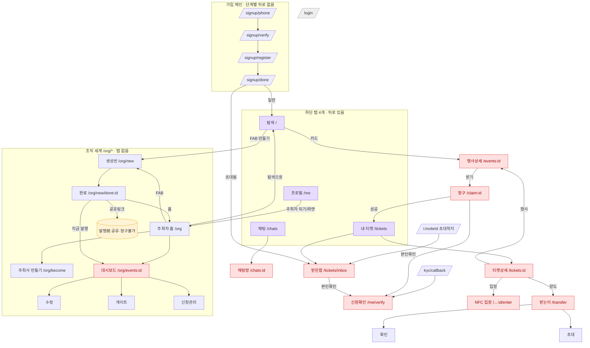

# UX 전문가 2/5 — 정보구조 & 내비게이션 리뷰 (2026-09-27)

- **대상**: `MONTI-web` (mvp-web @ ca9c8d7), 라이브 `https://monti.despell.io`
- **잣대**: 창업자 기준선 "중학생도 혼자 끝까지" — 막다른 길·뒤로 경로·진입점 중복·새로고침/복귀 상태
- **경로 표기**: 별도 명시 없으면 `apps/web/src/…`

## 핵심 진단 (한 줄)
**공용 뒤로 버튼이 없다.** `Screen`은 제목만 그린다(`shared/ui/Screen.tsx:3`). 하단 탭바는 정확히 4개 경로에서만
뜬다(`router.tsx:8,27` — `/ /tickets /chats /me`). 나머지 ~20개 스택 화면은 대부분 자체 뒤로 링크도 없어
**브라우저 back에만 의존**한다. 설치형 PWA/웹뷰에는 눈에 보이는 back이 없어, 중학생이 딱 막히는 지점이다.

## 화면 지도

> 빨강 = 앱 내 뒤로/출구 없음(브라우저 back 의존). 노랑 = 순서 함정.

## 막다른 길 · 출구 없음 (path:line)
1. **`Screen` 공용 뒤로 없음** — `shared/ui/Screen.tsx:3` · 탭바는 4경로만 `router.tsx:8,27`. (구조적 원인)
2. **행사상세 → 탐색 복귀 없음** — `attendee/discover/EventDetail.tsx:123-197` (청구·공유·기록만).
3. **청구 → 행사 복귀 없음** — `attendee/claim/Claim.tsx` (출구는 `/tickets`뿐, 딥링크 착지라 뒤가 비어있음).
4. **NFC 입장 = 완전 막다름** — `attendee/enter/Enter.tsx`·`Result.tsx` (어떤 navigate/Link도 없음).
5. **채팅방 → 목록 복귀 없음** — `attendee/chats/ChatRoom.tsx:132-177`.
6. **받은함 → /tickets 복귀 없음** — `attendee/tickets/Inbox.tsx:111-143`.
7. **티켓상세 성공뷰 목록 복귀 없음** — `attendee/tickets/Detail.tsx:56-75` (에러/누락뷰 `:42,51`엔 있음 — 불일치).
8. **신원확인 취소 없음** — `attendee/me/VerifyIdentity.tsx:142-161` (실수로 눌러도 못 빠짐).
9. **양도 받는이 → 티켓 복귀 없음** — `attendee/transfer/Recipient.tsx` (앞으로만).
10. **주최 대시보드 → /org 복귀 없음** — `organizer/Dashboard.tsx:200+` (수정/게이트/신청만).
11. **가입 각 단계 뒤로 없음** — `signup/Phone·Verify·Register` (전화 오타를 못 고침).

## 혼동되는 중복 진입점
- **조직 진입 3중 도어 + 목적지 분기**: 탐색 FAB `만들기`→`to`, 프로필 `주최자…`→`profileTo`, 탐색 빈상태 CTA→`to`.
  같은 사용자가 두 버튼에서 **다른 곳**으로 간다 — `organizer/useOrganizerEntry.ts:59-78`(`to`≠`profileTo`),
  `discover/Discover.tsx:45,167`, `me/Profile.tsx:117-137`. "만들기 vs 주최자 되기 vs /org 관리" 명칭도 혼재.
- **발행 전 공유 링크 노출**: 완료 화면이 링크·QR을 먼저 보여주는데 아직 Draft라 청구 불가 —
  `organizer/scene/Created.tsx:101-121`(경고) vs `:124`(발행). 친구가 죽은 링크를 받는다.

## 최소 탭 수 (핵심 여정)
| 여정 | 현재 | 개선안 |
|---|---|---|
| 친구 초대링크 참석(기존 로그인) | 1탭(받은함 자동→받기) | 1탭 (유지) |
| 친구 초대링크 참석(신규) | 5탭(전화·인증·패스키·이름·받기) | 5탭 (유지, 단계별 뒤로 추가) |
| 공개행사 링크로 참석(로그인) | **2탭**(상세 받기→청구 받기) | **1탭**(상세에 청구 흡수) |
| 행사 만들고 공유(권한 보유) | **4탭+되돌아가기**(공유링크가 떠난 완료화면에 있음) | **4탭·되돌아가기 0**(완료=발행+공유 한 화면) |

## 제안 IA
- **탭 4개 유지**(탐색/티켓/채팅/프로필). 채팅은 티켓 보유 시에만 의미 있으나 유지.
- **전역 상단 AppBar(뒤로 ‹) 추가**: 탭 루트가 아닌 모든 화면에 `Screen`이 자동 뒤로 렌더. **단일 최고효과 수정** —
  위 막다른 길 2~11을 한 번에 해소.
- **조직 세계 단일화**: FAB `행사 만들기`는 **항상** `/org/new`(조직 인라인 생성, 이미 구현). 관리(내 행사)는
  **프로필의 "내 행사" 섹션 하나**로. `to`/`profileTo` 분기·별도 "주최자 홈" 폐지 — 중학생에겐
  "만들기 + 내 행사 목록"이면 충분하다(별도 주최자 홈 불필요).
- **완료 화면에서 발행+공유 인라인**: create→publish→share 3목적지를 1화면으로. 발행 전엔 공유 링크 숨김.
- **화면별 primary CTA**: 상세=받기 · 티켓상세=입장 · 완료=지금 공개하기 · 각 뒤로는 상위 목록/이전 단계로.

## 바꿀 것 Top 10 (우선순위)
1. **P0 · 전역 뒤로(AppBar)** — `Screen.tsx:3`+`router.tsx:27`. 스택 화면 전체. (막다른 길 대부분 해소)
2. **P0 · 조직 진입 단일화** — `useOrganizerEntry.ts:59-78` 분기 삭제, `Discover.tsx:167`·`Profile.tsx:117-137`.
3. **P0 · 상세에 청구 흡수(시트)**, `/claim` 중간화면 제거 — `EventDetail.tsx:183`, `Claim.tsx`. (1탭 절감)
4. **P0 · 완료=발행+공유 한 화면** — `Created.tsx:124-135` + `Dashboard` 발행 흡수. (되돌아가기 제거)
5. **P1 · NFC 입장·채팅방·받은함·양도·대시보드 명시적 뒤로/닫기** — #4~10 각 path(1의 전역 뒤로로 대부분 커버).
6. **P1 · 티켓상세 성공뷰 목록 복귀 버튼** — `Detail.tsx:56-75`(에러뷰와 일치화).
7. **P1 · 발행 전 공유 링크 숨김** — `Created.tsx:101-121`.
8. **P1 · 신원확인 취소 버튼**(returnTo로 복귀) — `VerifyIdentity.tsx:142-161`.
9. **P2 · 가입 단계별 뒤로**(전화 오타 수정) — `Phone/Verify/Register`.
10. **P2 · 로그인에 "가입" 링크**(계정 없는 복귀자 구제) — `Login.tsx:111-133`.

## 새로고침 / 복귀 상태 메모
- 세션 재수화 레이스는 처리됨: `loading`을 별도 취급해 FAB 오라우팅 방지(`useOrganizerEntry.ts:67`, S5 수정 반영).
- 딥링크(`/events/:id`,`/claim/:id`,`/org/events/:id`)는 새로고침 생존 — 가드가 재적용. 초대 id는 sessionStorage로 생존.
- Didit 복귀: 웹은 `/me/verify?didit=done`로 평범한 페이지 로드, 마커 제거 후 폴링(`VerifyIdentity.tsx:95-102`) — 정상.
- 실패 op: 생성엔 홈 "확인 중" 배너 복구 경로 존재(`PendingCreateBanner`), **claim엔 재전송 없음**(라이브 4 S1) — IA보다 온체인 이슈.
